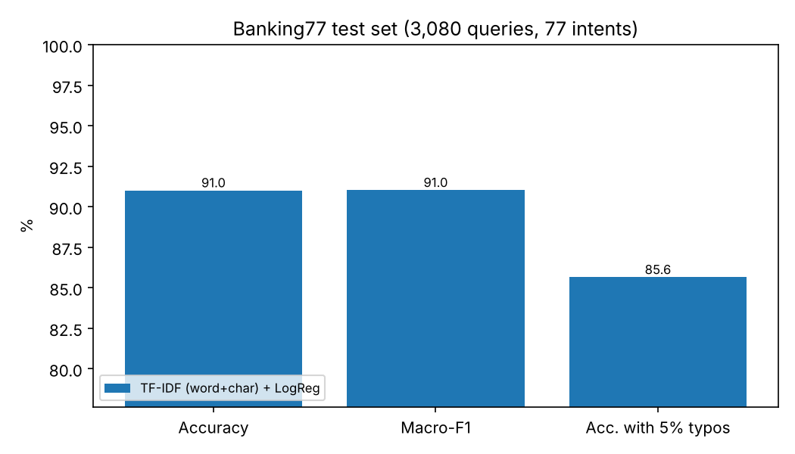
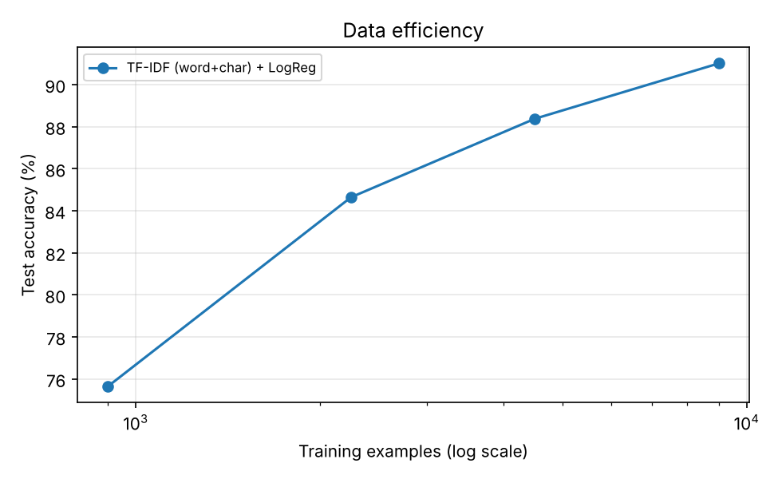

# Banking Intent Classification: TF-IDF vs. fine-tuned DistilBERT

[](https://github.com/Himani-gu/banking-intent-nlp/actions/workflows/ci.yml)


Classify a customer-service message ("my card still hasn't arrived") into one of **77 banking
intents**. The project compares a deliberately **strong classical baseline** (word + character
TF-IDF with logistic regression) against a **fine-tuned DistilBERT**, and goes beyond a single
accuracy number: data efficiency, robustness to typos, top-k accuracy, latency, and a
systematic error analysis. The best model is served through a **FastAPI** endpoint.

## What this project shows

- **Fair evaluation, not a leaderboard number.** Model selection uses a validation split; the
  official test set is used once per run. The baseline is tuned and uses character n-grams so
  the comparison with the transformer is not a straw man.
- **Beyond accuracy.** Macro-F1, top-3/top-5 accuracy, accuracy under synthetic typos, and
  single-query latency, all computed by one model-agnostic evaluation function.
- **Data efficiency.** Every model is trained on 10% / 25% / 50% / 100% of the training data
  while validation and test stay fixed.
- **Error analysis.** Per-class report, most-confused intent pairs, and a list of the most
  *confident* mistakes, which often expose ambiguous labels rather than model failures.
- **Engineering.** Custom PyTorch training loop (AdamW, linear warm-up/decay, gradient
  clipping, mixed precision), one inference interface for both models, a validated REST API,
  tests (including an offline end-to-end transformer smoke test) and CI.

## Dataset

[Banking77](https://arxiv.org/abs/2003.04807) (Casanueva et al., 2020): 13,083 online-banking
queries, 77 fine-grained intents, English. Official split: 10,003 train / 3,080 test. The CSVs
are downloaded automatically from the
[PolyAI repository](https://github.com/PolyAI-LDN/task-specific-datasets) on first run
(released under CC BY 4.0).

| Split | Size | Used for |
|---|---|---|
| Train | 9,003 | fitting (official train minus validation, stratified) |
| Validation | 1,000 | choosing C (baseline) / best epoch (transformer) |
| Test | 3,080 | final numbers only (official test split, never used for selection) |

> Note: the official label set contains a literal `reverted_card_payment?` (with a question
> mark). It is kept unchanged so results stay comparable with other work.

## Approach

| | Baseline | Transformer |
|---|---|---|
| Model | `TfidfVectorizer` (word 1-2 grams) + `TfidfVectorizer` (char_wb 3-5 grams) → `LogisticRegression` | `distilbert-base-uncased` (66M params) + classification head |
| Tuning | C ∈ {10, 30, 100} on the validation set | best of 5 epochs on the validation set |
| Training | scikit-learn, CPU, ~90 s | PyTorch loop: AdamW (lr 5e-5, wd 0.01), 10% linear warm-up then decay, grad-clip 1.0, batch 32, max length 64, optional fp16 |

**Robustness test.** Each test query is corrupted with random character-level typos (each
letter has a 5% chance of being deleted, swapped with its neighbour, doubled or replaced) using
a fixed seed, and accuracy is re-measured on the corrupted queries.

## Results

All numbers are on the official Banking77 **test set (3,080 queries)**, single run, seed 42.
The table below is generated by `scripts/make_report.py` from `results/*/metrics.json`.

<!-- RESULTS:START -->
| Model | Training data | Accuracy | Macro-F1 | Top-3 acc. | Acc. with 5% typos | Typo drop | Latency p50 / p95 (ms) | Device |
|---|---|---|---|---|---|---|---|---|
| TF-IDF (word+char) + LogReg | 10% (900) | 75.6% | 75.2% | 90.7% | 69.0% | -6.7 pts | 2.3 / 3.4 | cpu |
| TF-IDF (word+char) + LogReg | 25% (2,251) | 84.6% | 84.6% | 94.6% | 78.5% | -6.2 pts | 2.2 / 3.6 | cpu |
| TF-IDF (word+char) + LogReg | 50% (4,502) | 88.4% | 88.4% | 96.4% | 83.1% | -5.3 pts | 2.7 / 3.8 | cpu |
| TF-IDF (word+char) + LogReg | 100% (9,003) | 91.0% | 91.0% | 97.3% | 85.6% | -5.4 pts | 3.1 / 4.1 | cpu |
<!-- RESULTS:END -->




> **TODO before publishing (DistilBERT results are not in the table yet):**
> 1. Run `notebooks/colab_train.ipynb` on a free Colab T4 GPU (about 10 minutes).
> 2. Copy the downloaded `results/` folder into this repo and run `python scripts/make_report.py`.
> 3. Replace this block with a short "Transformer findings" paragraph written from *your* numbers
>    (accuracy gain, data-efficiency gap at 10%, typo robustness, latency). Do not publish claims
>    the table does not support.

### Findings (TF-IDF baseline, measured)

- **A well-built classical baseline is hard to beat.** 91.0% accuracy / 91.0% macro-F1, and the
  correct intent is in the top 3 predictions 97.3% of the time, which is useful for routing
  uncertain queries to a human agent.
- **Training data matters a lot at the low end.** Accuracy goes from 75.6% with 900 examples
  (about 12 per intent) to 84.6% with 2,251 and 91.0% with 9,003. This is the regime where a
  pretrained model is expected to help most.
- **Typos hurt.** 5% character noise costs 5-7 accuracy points even with character n-grams, and
  the drop is largest when training data is scarcest.
- **Speed.** Single-query latency is about 3 ms (p50) on CPU.
- **Statistical caveat.** With 3,080 test queries, a 95% confidence interval on 91% accuracy is
  roughly ±1 point, so differences smaller than that between runs should not be over-interpreted.

### Error analysis

Errors concentrate on **semantically adjacent intents**, not random mistakes. The most
confused pairs for the baseline (`results/tfidf_lr_frac1/top_confusions.csv`):

| True intent | Predicted | Count |
|---|---|---|
| `virtual_card_not_working` | `get_disposable_virtual_card` | 5 |
| `top_up_failed` | `top_up_reverted` | 5 |
| `balance_not_updated_after_bank_transfer` | `transfer_not_received_by_recipient` | 5 |
| `verify_my_identity` | `why_verify_identity` | 4 |

The weakest intents (lowest F1) are `balance_not_updated_after_bank_transfer` (0.74),
`top_up_failed` (0.76), `pending_transfer` (0.81) and `card_not_working` (0.82).

The **most confident mistakes** are revealing. Some are arguably annotation ambiguity rather
than model error, for example:

| Query | Labelled | Predicted |
|---|---|---|
| "My transfer is pending." | `balance_not_updated_after_bank_transfer` | `pending_transfer` |
| "How long does a card delivery take?" | `card_arrival` | `card_delivery_estimate` |
| "Where do I find the exchange rate?" | `exchange_charge` | `exchange_rate` |

This suggests part of the remaining error is a ceiling set by overlapping intent definitions,
which is worth keeping in mind when comparing models.

## Quickstart

```bash
git clone https://github.com/Himani-gu/banking-intent-nlp.git
cd banking-intent-nlp

python -m venv venv
source venv/bin/activate            # Windows: venv\Scripts\activate
pip install -e ".[dev]"             # baseline + API + tests
pip install -r requirements-nlp.txt # only needed for the transformer

pytest -q                           # offline tests; the transformer smoke test needs torch

python -m intent_nlp.baseline                  # train + evaluate the baseline (~1.5 min, CPU)
python -m intent_nlp.train_transformer --fp16  # fine-tune DistilBERT (GPU recommended)
python scripts/make_report.py                  # results table + figures + README refresh
```

Data-efficiency runs: add `--fraction 0.1` (also `0.25`, `0.5`) to either training command.
No GPU? Use `notebooks/colab_train.ipynb` on a free Colab T4.

### Predict from the command line

```bash
python -m intent_nlp.predict --model models/tfidf_lr_frac1/model.joblib "my card has not arrived"
python -m intent_nlp.predict --model models/distilbert_base_uncased_frac1 "my card has not arrived"
```

### Serve the API

```bash
uvicorn intent_nlp.api:app --port 8000
# or serve the transformer:
MODEL_PATH=models/distilbert_base_uncased_frac1 uvicorn intent_nlp.api:app --port 8000
# PowerShell:  $env:MODEL_PATH="models/distilbert_base_uncased_frac1"; uvicorn intent_nlp.api:app --port 8000
```

```bash
curl -X POST http://localhost:8000/predict \
  -H "Content-Type: application/json" \
  -d '{"text": "My card still hasnt arrived after two weeks", "top_k": 3}'
```

Example response from the baseline (values rounded; latency is for a warm call):

```json
{
  "intent": "card_arrival",
  "confidence": 0.954,
  "top_k": [
    {"intent": "card_arrival", "confidence": 0.954},
    {"intent": "reverted_card_payment?", "confidence": 0.010},
    {"intent": "card_delivery_estimate", "confidence": 0.006}
  ],
  "latency_ms": 3.4,
  "served_model": "tfidf_lr_frac1"
}
```

Other endpoints: `GET /health`, `GET /intents`, interactive docs at `/docs`. Blank text and
out-of-range `top_k` are rejected with HTTP 422.

## Project structure

```
src/intent_nlp/
  data.py               download, cleaning, stratified train/val/test + data-fraction splits
  baseline.py           TF-IDF (word+char) + LogReg: training, C selection, evaluation
  train_transformer.py  DistilBERT fine-tuning loop + evaluation through the serving path
  evaluate.py           accuracy/F1, top-k, typo robustness, latency, per-class + error files
  predict.py            one Predictor interface for both model types (+ CLI)
  api.py                FastAPI service
scripts/make_report.py  results table, figures, README refresh
notebooks/colab_train.ipynb   one-click GPU training on Colab
tests/                  data, evaluation, baseline, API, offline transformer smoke test
results/                metrics.json, per-class reports, confusions, error lists, figures
data/sample/            tiny hand-written fixture (8 intents) used only by the tests
```

## Design decisions

- **Custom training loop instead of `Trainer`.** Every step is explicit, and the script does not
  break when the `Trainer` API changes between `transformers` versions.
- **The test set is evaluated through the same `TransformerPredictor` the API uses**, so the
  reported numbers describe the code that is actually served.
- **Strong baseline on purpose.** Adding character n-grams makes the baseline robust to typos;
  a weaker baseline would inflate the transformer's apparent advantage.
- **Subsampling only touches training data**, so validation/test are identical across all
  data-efficiency runs.
- **Offline smoke test with a tiny randomly-initialised BERT** verifies training, checkpointing,
  loading and evaluation without downloading weights (it checks that the pipeline runs, not
  model quality).

## Limitations and next steps

- Single seed per configuration; multiple seeds with confidence intervals would make small
  differences interpretable.
- Typo noise is synthetic (uniform random character edits), not real user typos.
- Single domain, English only; Banking77 intents overlap, which caps achievable accuracy.
- Latency numbers depend on hardware (the baseline runs on CPU; the transformer on whatever
  device trained it), so compare them qualitatively.
- Ideas: confidence-threshold with human fallback, probability calibration, a larger model,
  ONNX/quantisation for CPU serving.

## References

- Casanueva et al. (2020). *Efficient Intent Detection with Dual Sentence Encoders.*
- Sanh et al. (2019). *DistilBERT, a distilled version of BERT.*

## License

MIT, see [LICENSE](LICENSE).
